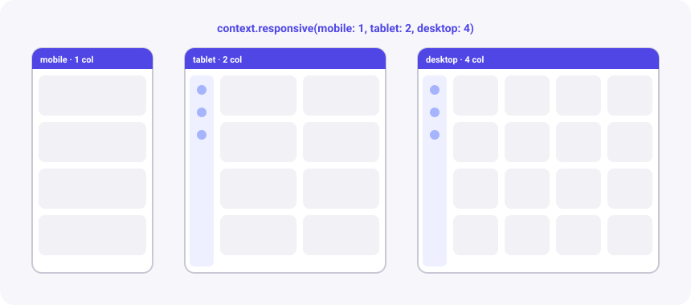

# breakpoint_builder

[](https://pub.dev/packages/breakpoint_builder)
[](https://github.com/senkop/breakpoint_builder/actions/workflows/ci.yml)
[](LICENSE)

Responsive layouts for Flutter: mobile, tablet and desktop, without the boilerplate. No dependencies.

- `BreakpointBuilder` with a layout per size (with fallbacks)
- `context.isMobile`, `context.isDesktop`, `context.screenSize`
- `context.responsive(mobile: 1, tablet: 2, desktop: 4)` for any value
- Measure the screen or just the parent (for side panels)
- Custom breakpoints with `BreakpointScope`



## Install

```bash
flutter pub add breakpoint_builder
```

## Usage

```dart
import 'package:breakpoint_builder/breakpoint_builder.dart';

BreakpointBuilder(
  mobile: (_) => const MobileHome(),
  desktop: (_) => const DesktopHome(), // tablet falls back to mobile
)

final columns = context.responsive(mobile: 1, tablet: 2, desktop: 4);

if (context.isMobile) ...
```

Defaults: mobile below 600, tablet from 600, desktop from 1024. Change them for a subtree:

```dart
BreakpointScope(
  breakpoints: const Breakpoints(tablet: 700, desktop: 1200),
  child: MyApp(),
)
```

## Example

```bash
cd example
flutter create .
flutter run -d chrome
```

## License

MIT
